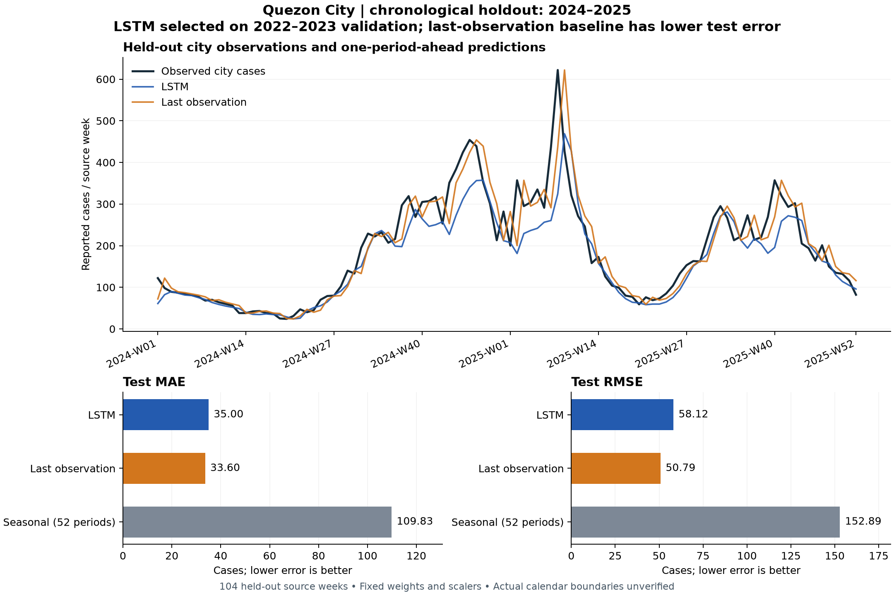

# Saved city forecasting evaluation

The LSTM has lower validation MAE, but the last-observation baseline has lower error on the untouched 2024–2025 test period. This run does not establish LSTM superiority.

This is a supplementary **city-level feasibility study**. It does not validate the original district-level 2018–2024 research scope, a combined BN–LSTM model, or a deployed early-warning system.



| Method | Validation MAE (cases) | Test MAE (cases) | Test RMSE (cases) |
|---|---:|---:|---:|
| LSTM | 11.79 | 35.00 | 58.12 |
| Last observation | 13.28 | 33.60 | 50.79 |
| Seasonal (52 periods) | 43.17 | 109.83 | 152.89 |

MAE is mean absolute error in case counts; RMSE penalizes larger errors more strongly. Neither is an accuracy percentage. No statistical significance claim is made.

| Split | Target source periods | Targets |
|---|---|---:|
| Train | 2010-W21 to 2021-W52 | 604 |
| Validation | 2022-W01 to 2023-W52 | 104 |
| Test | 2024-W01 to 2025-W52 | 104 |

The workbook has 832 rows (2010–2025). Eight rows form lag warm-up; twelve more form the initial sequence, leaving 812 targets. The seasonal baseline has only 564 eligible training targets because it requires 52 earlier periods; all methods share the same 104 validation and 104 test targets.

At each holdout target, the model receives only earlier observed periods. Parameters and scalers stay fixed. This measures rolling one-period-ahead forecasting; later holdout observations become available as history for later targets. It is not a single 104-step forecast made at the start of 2024.

Configuration: 2 LSTM layers; 64 hidden units; 12-period input; dropout 0.2; Adam learning rate 0.001; batch 16; seed 42; CPU with 1 thread. Best epoch 21 of 36 executed (maximum 80, patience 15).

Features: observed rainfall and city cases, plus their four- and eight-period lags. Input sequences end before the target. Scaling is fitted on training data only; epoch and method selection use validation MAE only. The saved model is not refitted on validation or test observations.

Workbook: `data/raw/Dengue-Rainfall_Dataset.xlsx`, sheet `QC Data`. Its dictionary attributes case counts to QCESD and rainfall to NASA satellite data. Those agency attributions have not been independently verified; rainfall is not labelled PAGASA.

Source SHA-256: `17ce7c50c73a2e8ce638688e4e87343a905972af9c3bdd881f2323c8fb5c3257`.

The workbook defines weeks 1–52 for every source year. Calendar dates and treatment of week 53 remain unverified. Outputs preserve source period labels. The last observation is 2025-W52, so extrapolations begin at 2026-W01, not the current date. Recursive multi-period forecasts and constant future rainfall scenarios have not been validated; no calibrated prediction intervals are available.

CPDD population, households, area, flood and waste references are prepared separately. They are not learned predictors in this city model. The Bayesian Network requires observed weekly barangay data and remains unavailable with the currently supplied data.

Reproduce from the repository root in PowerShell:

```powershell
& ./venv/Scripts/python.exe scripts/evaluate_city_forecast.py
& ./venv/Scripts/python.exe scripts/build_defense_report.py
```

The first command retrains and replaces the saved city artifact. The second reads saved results without retraining and checks the chart data against the model-card metrics. Do not choose seeds or settings by inspecting test performance; use a new holdout for future model selection.

Full evidence: `output/model-evaluation/model_card.json` and `holdout_predictions.csv`; runtime versions and per-epoch validation errors are recorded in the card. The API serves the same saved evidence at `GET /lstm/evaluation`. Further defense notes: [defense guide](defense_guide.md).

Method references: [scikit-learn leakage guidance](https://scikit-learn.org/stable/common_pitfalls.html) supports fitting preprocessing only on training observations; [chronological split guidance](https://scikit-learn.org/stable/modules/generated/sklearn.model_selection.TimeSeriesSplit.html) explains why future observations must not train earlier predictions. This implementation uses fixed year holdouts, not that class. [PyTorch reproducibility guidance](https://docs.pytorch.org/docs/stable/notes/randomness.html) describes the limits of reproducibility across environments.
